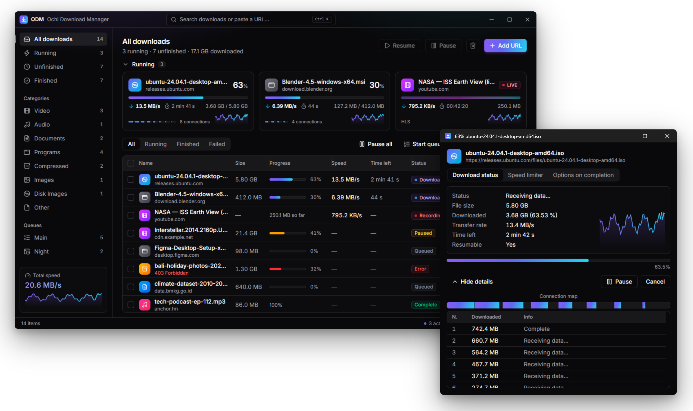

# Ochi Download Manager (ODM)

A segmented, resumable download manager for Windows, Linux and macOS, written
in Go. ODM opens several connections per file, resumes at the exact byte where
a transfer stopped, and organizes downloads into categories and scheduled
queues. It runs as a desktop app, or headless with a JSON API.



## Features

**Downloading**
- Up to 32 connections per file using `Range` requests (8 by default), with
  per-server overrides. The first connection opens immediately. Another opens
  after every connection already running has stored file bytes, up to the
  configured limit. Several connections use HTTP/1.1, one socket each.
  A single stream can still use HTTP/2.
- An idle connection takes half of the chunk that will take the longest to
  finish, when that chunk will take at least twice as long as the fastest
  one. Until a pace is known, it takes half of the largest remaining chunk.
- Resume after a pause, crash or restart from the exact byte offset. If a
  link expires, give the download a new address and it continues where it
  stopped, as long as the new address serves the same file.
- Range requests ask for the raw bytes (`Accept-Encoding: identity`), so a
  compressed response is not written in place of the file. A header set on
  the download itself is left as it is.
- A connection that closes before its chunk is finished retries from the
  last byte written, and stops after the retry limit.
- A saved `ETag` or `Last-Modified` is sent as `If-Range` on resume. If the
  file on the server has changed, the partial download is discarded and
  started again from the first byte. A `200` for a range that already covers
  the whole file is kept when that validator still matches.
- A later chunk re-reads a short stretch of the chunk before it. If the two
  copies differ, the rest of the file is fetched on one connection. If that
  copy still differs, the partial file is discarded and the download starts
  again from the first byte.
- A server that answers a smaller range with the whole file keeps bytes
  already stored. The remainder is fetched on one connection.
- Servers that do not support ranges are fetched on a single stream.
- Global and per-download speed limits, plus an optional data cap per time
  window. The global limit is switched off and on from the status bar (the
  Downloads menu on Linux and macOS) or the tray, and keeps its value while
  off.
- HTTP and SOCKS5 proxies, or the system proxy (the default).

**Organizing**
- Files are sorted into category folders (`Video/`, `Audio/`, `Documents/`, …),
  and each category can have its own destination folder. Categories and the
  file types they take can be added, deleted and changed.
- The New Download window remembers the save folder chosen last time, and
  falls back to the default folder when that one is gone.
- Named queues with a run order. Each queue can download a set number of files
  at once. A synchronization queue checks its finished files against the
  server and downloads the ones that changed again, replacing the local copy.
- A scheduler per queue: start with ODM, start at a set time (once or on chosen
  weekdays), start again every so many minutes until stopped, stop at a set
  time, retry failed files, and open a file, exit, sleep, hibernate or shut
  down when the queue finishes (after a 30-second countdown that can be
  cancelled).
- ZIP preview: the files inside a ZIP archive are listed before it is
  downloaded, reading only the end of the archive.
- Site logins (HTTP Digest or Basic, sent only to a host that asks), import
  and export of the download list, and a site
  grabber that crawls a page and queues the files it links to.
- A new download never replaces an existing file: if the name is taken, it is
  saved as `name (2).ext`. Adding a link that is already in the list asks
  first, or follows a setting for the browser, clipboard and grabber.

**Desktop**
- A main window with categories and queues at the side, a card for each
  running download (speed over the last minute, its connections, time
  left), and a list that sorts, resizes and hides its columns, selects
  several rows, and stays quick with thousands of downloads. The search box
  (Ctrl+K) filters the list, takes a pasted address, and runs any command
  by name.
- A progress window per download that shows each connection, and a dialog when
  a download completes.
- Light and dark themes that follow Windows or are chosen in Options, in
  English or Indonesian.
- Narrator and other screen readers read every part of the windows, and
  the keyboard reaches all of it (in the list: the arrows to move and
  select, the Menu key for a download's menu).
- Runs from the system tray, with the system's notifications when a
  download finishes or fails. ODM can launch at login, and starting it again brings
  the running window forward.
- Checks GitHub Releases for new versions. It only notifies; it never updates
  itself.
- The windows are a page drawn by the system's web view
  ([Wails](https://wails.io)): Microsoft Edge WebView2 on Windows,
  WebKitGTK on Linux and WebKit on macOS. ODM's previous windows, built
  with [Fyne](https://fyne.io) and with the same features, remain as a
  build for older Linux distributions.

**Integration**
- A browser extension (Chrome, Edge, Firefox) hands downloads to ODM through
  native messaging, and opens them in a *New Download* window where you
  choose the folder and name, and for a stream the quality and audio track. ODM can register itself with each browser.
- A **Download this video** button appears over a video player when the
  extension sees the page load a video or audio file. It names the file
  after the page title. Streams split into many segments (HLS/DASH) are
  downloaded segment by segment in the quality you pick (the best by
  default); separate video and
  audio tracks are joined with [ffmpeg](https://ffmpeg.org/) if it is
  installed (next to ODM, on PATH, or chosen in Options > Downloads, which
  also shows the ffmpeg version ODM found). A live stream (HLS, DASH, or
  one endless response such as FLV) is recorded until you stop the
  download (Pause or Stop), the broadcast ends, or nothing new arrives for
  a while. Facebook and Instagram broadcasts are recorded from the
  manifest their signed-in player loads. A result in
  MPEG-TS becomes MP4 when it finishes (copied, not re-encoded; Matroska
  when the streams do not fit MP4). DRM-protected video is not supported
  and never will be.
- On YouTube (watch pages, Shorts, embedded players) the button lists the
  video's qualities and audio-only formats as
  [yt-dlp](https://github.com/yt-dlp/yt-dlp) reads them, and ODM downloads
  the one you pick through yt-dlp, with its progress, pause and resume.
  A YouTube address pasted into *New Download* works the same way. yt-dlp
  reads the page itself and signs in to the site as you, as YouTube asks of
  some visitors ("Sign in to confirm you're not a bot"): by default with
  the cookies of the browser you download from, which works in any browser
  with ODM's extension, Chrome included. The extension sends the site's
  cookies with the page, and ODM keeps them in memory for yt-dlp, which
  gets them in a cookie file removed after each run. *Options → Programs*
  ("Sign in to video sites with the cookies of") turns this off, or names
  a browser whose cookies yt-dlp reads itself instead, which works with
  Firefox; Chrome and other Chromium browsers lock their cookies while
  open, and recent Chrome encrypts them. When yt-dlp cannot list a video's
  qualities, the button's menu says why.
- A broadcast on such a page (YouTube Live, Twitch, TikTok and others
  yt-dlp reads) shows "● LIVE" with a Record row per quality. ODM records
  the playlist or stream yt-dlp finds with its own recorder, from the
  click until you stop it, and asks yt-dlp for a fresh address when the
  old one expires. A live stream sent as one endless response (TikTok's
  FLV, which the button also offers when the player loads it) is recorded
  in parts that ffmpeg joins into one MP4.
- yt-dlp and ffmpeg need no installing. The first time one is needed, ODM
  asks whether it may download them (about 20 MB): yt-dlp from its own
  releases, and a small ffmpeg built for ODM that only copies streams
  between containers (`scripts/ffmpeg-min.sh`, published by the
  `ffmpeg-min` workflow, LGPL). Each is checked against the SHA-256 its
  release lists, kept in `%LocalAppData%\odm\tools`, and updated silently
  once a day. Options > Downloads turns this off, updates them now, or
  points at copies of your own, which ODM otherwise also finds next to it
  or on PATH.
- The extension's toolbar icon counts the media a page has loaded, and its
  popup lists them (from every frame) for players the button cannot find.
- A clipboard monitor queues downloadable URLs you copy. You can turn it on
  or off at any time.

## Install

Once a version is tagged, prebuilt archives are attached to
[GitHub Releases](https://github.com/rigaz29/odm/releases):

| Platform | Archive |
| -------- | ------- |
| Windows x64 | `odm-windows-amd64.zip` |
| Linux x64 | `odm-linux-amd64.tar.gz` |
| Linux ARM64 | `odm-linux-arm64.tar.gz` |
| Linux x64, older distributions | `odm-linux-amd64-fyne.tar.gz` |
| Linux ARM64, older distributions | `odm-linux-arm64-fyne.tar.gz` |
| macOS (Apple silicon) | `odm-darwin-arm64.tar.gz` |
| macOS (Intel) | `odm-darwin-amd64.tar.gz` |

Unpack the archive and run `ODM.exe` (Windows) or `./odm` (Linux, macOS).

On Windows ODM needs the Microsoft Edge WebView2 Runtime. It comes with
Windows 11 and with Windows 10 kept up to date; where it is missing, ODM
says so and offers Microsoft's
[download page](https://developer.microsoft.com/microsoft-edge/webview2/).

On Linux ODM needs GTK 4 and WebKitGTK 6.0 (the `libwebkitgtk-6.0-4`
package on Debian and Ubuntu, `webkitgtk6.0` on Fedora), which Ubuntu
24.04, Debian 12, Fedora 39 and later have. On older distributions, such
as Ubuntu 22.04 or Linux Mint 21, take the `-fyne` archive: ODM's previous
windows, built with Fyne, with the same features. On GNOME the tray icon
needs the AppIndicator extension.

On macOS open ODM the first time with right-click → Open, since it is not
signed. It shows no notifications there, since it is not an `.app`.

On Linux and macOS the windows run as they are, not polished yet: they
keep the system's window frame and label shortcuts Ctrl.
Settings and download state are stored in `<config>/odm/`. `<config>` is
`%AppData%` on Windows, `~/Library/Application Support` on macOS and `~/.config`
on Linux.

### Build from source

ODM needs Go 1.25 or later. The engine uses only the standard library. The
desktop UI (`internal/gui`, the `gui` build tag) is a React page embedded
in the program, so its page is built first with Node.js 22 or later. On
Windows it needs no cgo; on Linux and macOS it does. The previous UI,
built with Fyne behind the `fyne` build tag, needs cgo everywhere.

| Target | Command | Requirements |
| ------ | ------- | ------------ |
| Windows | `./scripts/build.sh windows` | Node.js and npm |
| Linux | `./scripts/build.sh linux` | Node.js and npm, `libgtk-4-dev libwebkitgtk-6.0-dev` |
| macOS | `./scripts/build.sh darwin` (or `darwin-intel`) | Node.js and npm, Xcode command line tools |
| Linux, Fyne UI | `./scripts/build.sh linux-fyne` | `libgl1-mesa-dev xorg-dev libxkbcommon-dev` |
| macOS, Fyne UI | `./scripts/build.sh darwin-fyne` | Xcode command line tools |
| Windows, Fyne UI | `./scripts/build.sh windows-fyne` | mingw-w64 (`CC_WINDOWS`, default `x86_64-w64-mingw32-gcc`) |
| Headless | `./scripts/build.sh cli` | none |

```bash
go test ./...                                    # engine tests, no UI needed
(cd internal/gui/frontend && npm ci && npm test && npm run build)  # the desktop UI's page
go test -tags gui ./internal/gui ./internal/i18n # the desktop UI's Go side (cgo on Linux and macOS)
go build -tags gui,production -ldflags -H=windowsgui -o ODM.exe ./cmd/odm  # Windows desktop build
go build -tags gui,production -o odm ./cmd/odm   # Linux or macOS desktop build
go test -tags fyne ./internal/ui                 # Fyne UI tests (cgo)
go build -tags fyne -o odm ./cmd/odm             # Fyne desktop build for the current OS
```

`scripts/winres.sh` rebuilds the Windows resources linked into every
Windows build (manifest, icon, name) when one of them changes.

## Usage

```bash
ODM.exe                                  # open the app
ODM.exe -hidden                          # start in the system tray
ODM.exe -add https://host/big.iso -no-ui # fetch one URL in the terminal, then exit
```

| Flag | Meaning |
| ---- | ------- |
| `-dir`, `-conns`, `-files` | Override the download folder, connections per file, and simultaneous downloads |
| `-add URL` | Download one URL headless and exit |
| `-no-ui`, `-open` | Run without a window / control whether a window opens |
| `-hidden` | Start in the tray (used by launch-at-login) |
| `-serve`, `-addr` | Also serve the web UI and API on `-addr` (default `127.0.0.1:8721`) |
| `-register-browser`, `-unregister-browser` | Register or remove the browser native host |
| `-version` | Print the version |

**Keyboard shortcuts** (main list): <kbd>Ctrl</kbd>/<kbd>Shift</kbd>+click to
select several downloads, <kbd>Ctrl</kbd>+<kbd>A</kbd> to select all,
<kbd>Del</kbd> to remove, <kbd>Enter</kbd> to open the progress window, arrow
keys to move, <kbd>Ctrl</kbd>+<kbd>N</kbd> to add a URL, and
<kbd>Ctrl</kbd>+<kbd>F</kbd> to search. The search box keeps the downloads
whose file name, address or description contains every word typed;
<kbd>Esc</kbd> clears it. On Windows, also <kbd>Ctrl</kbd>+<kbd>K</kbd> for the
search box, which runs commands by name as well, <kbd>Space</kbd> to pause or
resume, <kbd>Shift</kbd>+<kbd>Del</kbd> to remove and delete the files,
<kbd>Ctrl</kbd>+<kbd>C</kbd> to copy the addresses, and the Menu key or
<kbd>Shift</kbd>+<kbd>F10</kbd> for the selected download's menu. On macOS,
use <kbd>Cmd</kbd> instead of <kbd>Ctrl</kbd>.

**Notifications.** A system notification says when a download finishes or
fails, unless its complete dialog was just shown while ODM is in front. On
Windows, ODM can also play the system sound for these events. Both are in
*Options → Downloads*.

**Tray and start-up.** Closing the window hides ODM in the tray, and downloads
keep running. *Options → General* controls close-to-tray and *Launch ODM on
startup*. Launch-at-login is registered for the current user only: the `Run`
key under `HKCU` on Windows, an XDG autostart entry on Linux, and a LaunchAgent
on macOS. On Linux desktops without a tray (for example GNOME without an
AppIndicator extension), the icon may not appear. Starting ODM again still
shows the window.

**Proxy.** *Options → Proxy / Socks* offers three choices:
- No proxy.
- System settings (the default): the `HTTP(S)_PROXY` variables, and on Windows
  also the proxy set in Internet Options. Automatic configuration (PAC)
  scripts are not evaluated.
- A manual HTTP or SOCKS5 proxy.

## Browser integration

1. Start ODM once: it registers itself with Chrome, Edge, Chromium and
   Firefox. *Options → General* shows the status. (`ODM.exe
   -register-browser` does the same from a shell.)
2. Install the extension. On Windows, ODM's Setup window (it opens at the
   first start; later ⋯ → *Help* → *Set up ODM…*) lists your browsers and
   installs it in each: Firefox asks to add the signed add-on, and for
   Chrome, Edge, Brave or Opera it gives the folder to load and the steps.
   It installs yt-dlp and ffmpeg too. Or from the release:
   - Chrome, Edge, Brave, Opera: unzip `odm-extension-chromium.zip`, then
     *Developer mode* → *Load unpacked* in `chrome://extensions`.
   - Firefox: open `odm-extension-firefox.xpi` (signed by Mozilla).
3. Restart the browser once.

[extension/README.md](extension/README.md) has the details, including where
the registration is written on each OS.

## Security model

ODM opens **no TCP port by default**. A running instance listens on a Unix
domain socket in the user's config directory (`odm.sock`). The browser relay
uses this socket, and it also stops a second copy of ODM from starting. Web
pages can send requests to `127.0.0.1` but cannot reach a socket file, so
websites you visit cannot reach the API. The socket needs Windows 10 version
1803 or later. Without it, ODM still runs, but browser hand-off is disabled.

`-serve` exposes the web UI and API over TCP. That listener requires a random
token generated at each start and printed at start-up. Opening `/?token=…`
sets a `SameSite=Strict` cookie; scripts send the `X-ODM-Token` header.
Requests from any other `Origin` are refused.

## Headless mode and HTTP API

Builds without the desktop UI (`./scripts/build.sh cli`), or runs with
`-serve`, serve a basic web UI and this JSON API. The web UI covers
adding, pausing and removing downloads. Scheduler and most Options are desktop
only.

| Method | Path | Purpose |
| ------ | ---- | ------- |
| GET / PUT | `/api/settings` | Read or update settings (applied immediately) |
| GET / POST | `/api/downloads` | List downloads, or add `{"url","dir","connections","headers","speed_limit"}` |
| GET / DELETE | `/api/downloads/{id}` | One download; `DELETE ?file=true` also deletes the file |
| POST | `/api/downloads/{id}/pause` \| `/resume` \| `/retry` \| `/open` \| `/reveal` | Control a download |
| POST | `/api/downloads/{id}/limit` \| `/options` | Per-download speed limit / open-when-done |
| GET | `/api/probe?url=` | Size, type and file name of a URL without adding it |
| POST | `/api/probe/stream` | Qualities of an HLS/DASH playlist `{"url","headers"}`; an add with `"stream"` takes one as `"quality"` |
| POST | `/api/probe/site` | Qualities yt-dlp finds at a video page `{"url"}` (503 `"missing"` without yt-dlp); an add with `"site": true` takes one's `"format"` |
| POST | `/api/actions/pause-all` \| `/stop-all` \| `/resume-all` \| `/clear-completed` | Batch actions (`stop-all` also stops started queues) |
| GET | `/api/events` | Server-Sent Events stream of the list |

## How a download works

1. **Probe.** A ranged `GET bytes=0-0` returns the file size, range support,
   file name, cookies and validators.
2. **Plan.** The file is split into up to N chunks of at least 64 KiB. A tiny
   last chunk is merged into the one before it.
3. **Transfer.** Workers write each chunk into the `.odmpart` file at its
   absolute offset. Each range request asks for the raw bytes. With more than
   one connection the requests use HTTP/1.1, so each connection has its own
   socket. The first connection opens immediately. Another opens after every
   connection already running has stored file bytes, up to the configured
   limit. A worker that finishes early takes half of the chunk with the most
   time left, when that chunk will take at least twice as long as the fastest
   one. Until a pace is known, that is the largest remaining chunk. Bytes past
   that chunk's new end are left for the connection that took them. A
   connection that receives no bytes for 30 seconds, including while it waits
   for response headers, is closed and that chunk is retried from the last
   byte written. The other connections keep going. If the server answers a
   smaller range with the whole file, bytes already stored are kept and the
   remainder is fetched on one connection.
4. **Finish.** The `.odmpart` file is renamed to the final name.

Each chunk's progress (`{id,start,end,done}`) is saved as JSON, together with
the `ETag` and `Last-Modified` from the probe, so a restart continues from
the exact byte while the file on the server is unchanged. If `If-Range` fails,
or a later probe reports a different validator or size, ODM deletes the partial
file and downloads the new one. A `200` for a range that already covers the
whole file is kept when the validator still matches. A chunk that starts after
another one also reads 64 bytes of that earlier chunk and compares the two
copies. When they differ, the other connections stop and one connection
finishes from the last matching byte. If that copy differs as well, the
partial file is deleted and downloaded again from the first byte, still on
one connection. A resume after this fallback stays on one connection.
Segmented ranges, byte-offset resume and chunk splitting are standard
download-manager techniques. ODM implements them in its own code.

## Project layout

```
cmd/odm             entry point: desktop app, native-messaging relay, headless mode
internal/engine     probe, chunk planner, transfers, queues, scheduler, settings, state
internal/gui        desktop UI (Wails: WebView2, WebKitGTK, WebKit): the service, tray and windows; the React page in frontend/
internal/ui         previous desktop UI (Fyne), kept for older Linux: main window, progress, Scheduler, Options
internal/i18n       the translations both desktop UIs share
internal/server     JSON + SSE API, token guard, embedded web UI
internal/ipc        Unix-socket control channel and single-instance lock
internal/native     native-messaging framing and browser-launch detection
internal/browserreg native-host registration for Chrome, Edge, Chromium, Firefox
internal/sysproxy   OS proxy lookup (environment, Windows Internet Options)
internal/autostart  launch at login (Run key, XDG autostart, LaunchAgent)
internal/update     GitHub Releases version check
internal/clipmon    clipboard watcher (native on Windows, polled by the desktop UI elsewhere) and URL detection
internal/osutil     open, reveal and shutdown helpers
cmd/extpack         builds the Chromium (.zip) and Firefox (.xpi) extension packages
internal/extpack    per-browser manifest derivation and packaging
extension/          MV3 browser extension source and native-host manifests
```

## Roadmap

- A properties dialog for each download.
- A credentials prompt for HTTP 401 responses from a host with no site login.
- A virus-scan hook, grabber projects, and translations.
- Signed self-update, and code-signed Windows builds.

## License

[MIT](LICENSE) © 2026 Ochi Download Manager contributors.

ODM is an independent implementation. It ships no code, binaries, assets or
data from any other product, and it does not bypass copy protection or
activation. Copyright protects expression, not ideas. This project claims
rights only over its own source and asserts none over any idea, algorithm or
behavior. See [DISCLAIMER.md](DISCLAIMER.md) for the full statement.
